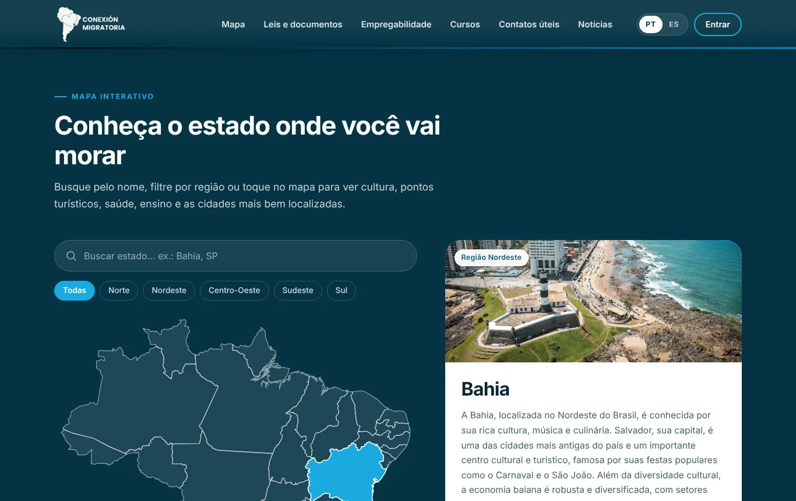

<div align="center">
  <picture>
    <source media="(prefers-color-scheme: dark)" srcset="img/logo-branca-conexion-migratoria.png">
    
  </picture>

  # Conexión Migratoria

  **O seu portal de apoio para começar uma nova vida no Brasil.**<br>
  *Tu portal de apoyo para empezar una nueva vida en Brasil.*

  <a href="https://biabruna19.github.io/Conexion-Migratoria/"></a>

  🔗 **https://biabruna19.github.io/Conexion-Migratoria/**

  
  
  
  
</div>

<br>

<p align="center">
  <a href="https://biabruna19.github.io/Conexion-Migratoria/"></a>
</p>

> 💡 **Para testar:** abra o site, clique em **Entrar** e escolha **"entrar como visitante"**. Não é preciso criar conta. Use o botão **PT/ES** no topo para trocar o idioma.

---

O movimento migratório cresce em várias partes do mundo. O Conexión Migratoria reúne, num só lugar, informações para que imigrantes e refugiados conheçam o Brasil, regularizem seus documentos, encontrem trabalho, aprendam português e saibam onde pedir ajuda.

## ✨ Funcionalidades

- 🗺️ **Mapa interativo**: busca por nome ou sigla, filtro por região e uma página para cada um dos 27 estados (cultura, pontos turísticos, saúde, ensino e cidades).
- 📜 **Leis e documentos**: os principais documentos, os primeiros passos ao chegar, autorização de residência, naturalização e leis importantes.
- 💼 **Empregabilidade**: currículo, entrevistas e LinkedIn.
- 🎓 **Cursos**: videoaulas de português do básico ao avançado e ONGs com cursos gratuitos.
- ☎️ **Contatos úteis**: números de emergência, Polícia Federal, Defensoria Pública da União, CONARE, ACNUR e organizações de apoio por região.
- 📰 **Notícias**: seleção de notícias de 2026 sobre migração e refúgio no Brasil.
- 🌐 **Português e espanhol**: textos escritos à mão nos dois idiomas, sem tradução automática.
- 👤 **Conta e perfil**: cadastro, login, recuperação de senha, edição de dados e foto de perfil.
- 📱 **Responsivo e acessível**: menu mobile, navegação por teclado (inclusive no mapa) e suporte a quem prefere menos animações.

## 🗺️ Mapa interativo

<p align="center"></p>

## 🧪 Modo demonstração

O site roda **100% no GitHub Pages, sem servidor e sem banco de dados**, para que qualquer pessoa consiga testar todas as funções:

- O conteúdo dos estados fica em [`data/estados.js`](data/estados.js), recuperado do banco de dados original do projeto.
- Contas, sessão e foto de perfil ficam salvas **apenas no navegador** de quem está testando (`localStorage`). As senhas são guardadas como hash SHA-256, nunca em texto puro.
- Na tela de login há a opção **"entrar como visitante"**, para conhecer o site sem criar conta.

## 💻 Tecnologias

- HTML5, CSS3 e JavaScript puro, sem frameworks nem dependências.
- Sistema visual próprio (`css/estilo.css`) com a identidade original do projeto: tons de azul e fonte Inter.
- Ícones em SVG embutidos no próprio código.
- Histórico: o projeto nasceu com PHP + MySQL (XAMPP), passou por Supabase e hoje é um site estático.

## 📁 Estrutura

```
├── index.html            # Início: apresentação, serviços, mapa, notícias
├── pg-estados.html       # Página de cada estado (?uf=SP, ?uf=BA...)
├── leis.html             # Leis e documentos
├── pg-empregos.html      # Empregabilidade
├── pg-cursos.html        # Cursos
├── contatos.html         # Contatos úteis
├── pg-perfil.html        # Perfil do usuário
├── logar.html, criarConta.html, recuperarSenha.html, redefinirSenha.html
├── css/estilo.css        # Sistema visual do site inteiro
├── data/estados.js       # Conteúdo dos 27 estados (PT) e resumos (PT/ES)
├── js/
│   ├── idioma.js         # Português/espanhol
│   ├── demo-store.js     # Contas e sessão no navegador (modo demonstração)
│   ├── layout.js         # Topo, menu mobile, rodapé e ícones
│   ├── mapa.js           # Mapa interativo com busca e filtro por região
│   ├── estado.js         # Página de cada estado
│   ├── componentes.js    # Abas e sumário
│   ├── conta.js          # Login, cadastro e recuperação de senha
│   └── perfil.js         # Página de perfil
├── img/                  # Logotipo, ícone do site e avatar padrão
├── docs/                 # Imagens usadas neste README
└── imgs-estado/          # Fotos dos estados (WebP)
```

## 🛠️ Como rodar localmente

1. Clone o repositório:
   ```bash
   git clone https://github.com/biabruna19/Conexion-Migratoria.git
   ```
2. Abra o arquivo `index.html` no navegador (dois cliques) ou use a extensão **Live Server** do VS Code.

Não é preciso instalar nada nem configurar banco de dados.

> As informações do site são uma referência educacional e não substituem a orientação dos órgãos oficiais.
