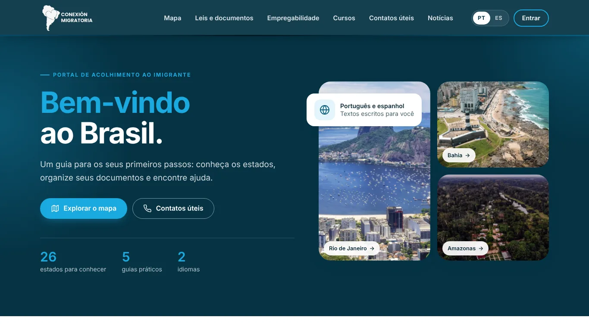
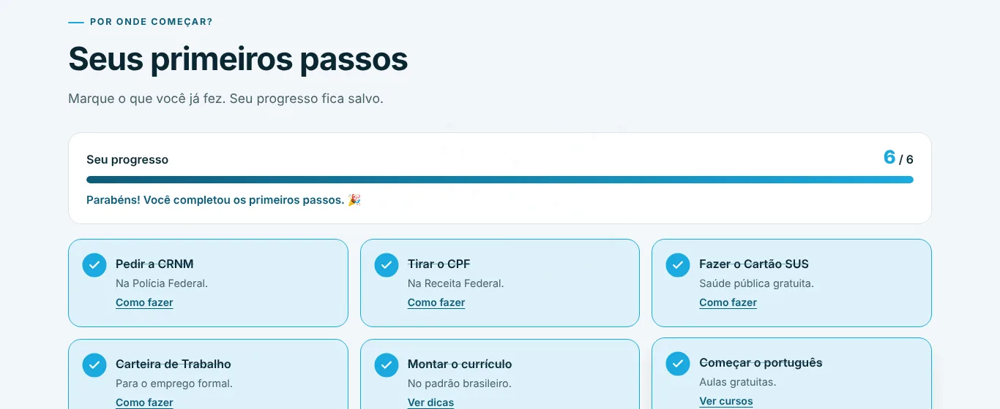

<p align="center">
  <picture>
    <source media="(prefers-color-scheme: dark)" srcset="img/logo-branca-conexion-migratoria.png">
    
  </picture>
</p>

<h3 align="center">
  <a href="https://biabruna19.github.io/Conexion-Migratoria/">Ver o site → biabruna19.github.io/Conexion-Migratoria</a>
</h3>

<p align="center">
  
</p>

## Sobre

O Conexión Migratoria é um portal para quem acabou de chegar ao Brasil como imigrante ou refugiado. A ideia é juntar num lugar só o que normalmente fica espalhado: como é cada estado, quais documentos tirar primeiro, como procurar emprego, onde aprender português e a quem pedir ajuda.

O português e o espanhol têm textos escritos à mão, porque boa parte de quem chega fala espanhol. Pelo globo no topo dá para ler o site em mais 16 línguas, como inglês, francês, crioulo haitiano e árabe, com tradução automática.

## O que dá para fazer

- Explorar o mapa do Brasil, buscar um estado pelo nome ou deixar o site sortear um, e abrir a página de cada estado com cultura, galeria de pontos turísticos, saúde, ensino, cidades e os outros estados da região.
- Marcar os primeiros passos e os documentos que já tem. O progresso fica salvo.
- Praticar frases do dia a dia em cartões que viram, falam a pronúncia e mostram a tradução em espanhol, inglês, francês, crioulo haitiano ou árabe.
- Descobrir o nível de português com um teste rápido de três perguntas.
- Ver dicas de currículo, entrevista e LinkedIn.
- Encontrar números de emergência, órgãos públicos e organizações de apoio por região.
- Criar uma conta, se quiser, para guardar o perfil e a foto. Nenhuma página exige login.

<p align="center">
  
  
</p>

<p align="center">
  
</p>

## Como testar

É só abrir o [site](https://biabruna19.github.io/Conexion-Migratoria/): todas as páginas funcionam sem login. O globo no topo troca o idioma. Para testar a parte de conta, use **Entrar → entrar como visitante**.

O site roda direto no GitHub Pages, sem servidor nem banco de dados. As contas e fotos ficam guardadas só no navegador de quem está testando, e as senhas são salvas em hash, nunca em texto puro.

## Tecnologias

HTML, CSS e JavaScript, sem frameworks. O conteúdo dos 27 estados fica em `data/estados.js`.

O projeto começou em PHP com MySQL, rodando no XAMPP. Depois passou pelo Supabase e hoje é um site estático, o que permite publicar de graça e deixar qualquer pessoa testar todas as funções.

## Rodando no computador

```bash
git clone https://github.com/biabruna19/Conexion-Migratoria.git
```

Depois é só abrir o `index.html` no navegador, ou usar a extensão Live Server do VS Code.

## Organização das pastas

```
index.html, pg-estados.html, leis.html, pg-empregos.html,
pg-cursos.html, contatos.html, pg-perfil.html   páginas do site
logar.html, criarConta.html, recuperarSenha.html,
redefinirSenha.html                             telas de conta
css/estilo.css                                  estilos
js/                                             scripts (mapa, idiomas, conta, interações)
data/estados.js                                 conteúdo dos estados
imgs-estado/                                    fotos dos estados
docs/                                           imagens deste README
```

---

As informações do site servem como referência e não substituem a orientação dos órgãos oficiais.
